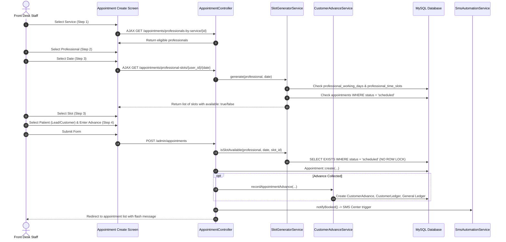
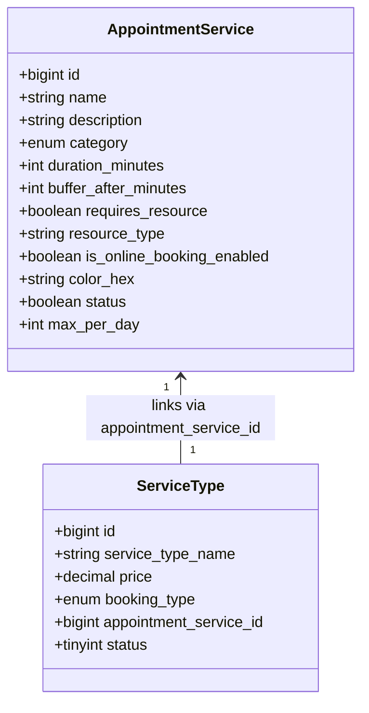
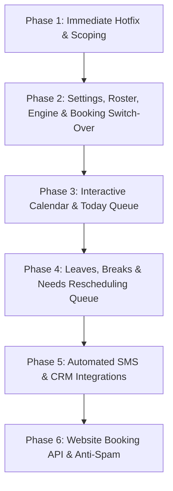

# Appointment Module Redesign Plan: Comprehensive Analysis & Architectural Specification

**Document Version:** 2.0 (Revised Architectural Plan)  
**Target File:** `docs/APPOINTMENT_PLAN.md`  
**Timezone:** `Asia/Dhaka` (UTC+06:00)  
**Status:** Architectural Analysis & Specification (NO CODE / NO DB CHANGES EXECUTED)

---

## Executive Summary

This document presents a comprehensive, deep-dive architectural analysis of the current Appointment module in the CRM, followed by an actionable, enterprise-grade redesign specification.

The existing appointment system relies on a rigid **1-hour static slot pivot architecture** (`time_slots` and `professional_time_slots`), lacks resource tracking (such as branch sound booths), ignores branch boundaries (`DataScope::appointments` is defined but unused), has no concept of staff breaks, leaves, or branch holidays in its booking logic, and is vulnerable to race conditions and foreign-key corruption.

This revised specification incorporates all business rules and management decisions:
1. **Branch Visibility & Scoping:** Scoped strictly via `DataScope` and branch filters. Branch users see only their branch; Head Office and Super Admin have global visibility and branch filtering.
2. **Single Source of Truth:** Scheduling settings (`duration`, `buffer`, `resource`, `online flag`, `color`) live on `appointment_services`; pricing and booking type (`walk_in`, `appointment_required`, `either`) live on `service_types`. The booking screen reads both via the existing foreign key `service_types.appointment_service_id`.
3. **Branch Settings & Unified Weekdays:** Dedicated branch opening hours and weekly off days (default Friday) per branch. Universal adoption of **ISO-8601 (1=Monday ... 7=Sunday, Friday=5)** across all modules.
4. **Staff Rotation Rule:** A professional works at **only one branch per day**, but may rotate across different branches on different days. Roster and override validation strictly forbids split-branch days for the same staff member.
5. **No Forced Defaults for Legacy Data:** The migration will **not** guess branches or invent times for existing appointments. Staff branch mapping requires an interactive prompt before migration. Appointments with missing times are preserved with `"time unknown"` status. Synthetic test appointments (#12–#22) and appointments assigned to Super Admin (`user_id = 1`) are catalogued for explicit review and approved deletion.
6. **Robust Concurrency Locking:** Double-booking prevention locks the `users` row of the professional and the `resources` row (`SELECT ... FOR UPDATE`), not transient appointment rows.
7. **Database-Backed Website Holds:** Temporary website slot reservations use a dedicated `appointment_holds` database table with auto-expiry, avoiding external cache dependencies like Redis.
8. **Fast-Value Phasing:** Phases are restructured so that hotfixes occur first, followed immediately by the core engine, settings, and the live switch-over of the new 3-step booking screen before secondary calendar, leave, or website features are built.

---

# PART 1 – Comprehensive Analysis of the Current Module

## 1.1 How It Works Today

### Screens & Navigation
The current appointment module comprises the following admin screens:
1. **Appointment List (`admin/appointments` / `AppointmentController@index`):**  
   Tabular view of appointments with filters for Professional (`user_id`), Service (`service_id`), Status (`status`), Lead (`lead_id`), Customer (`customer_id`), and Date Range (`start_date`, `end_date`).  
   *Major Defect:* Does **not** apply any branch filter or `DataScope`. Any branch user sees appointments from all other branches.
2. **Book Appointment (`admin/appointments/create` / `AppointmentController@create`):**  
   A 4-step wizard interface:
   - *Step 1 (Service):* Radio cards listing records from `appointment_services`.
   - *Step 2 (Professional):* Radio cards loaded via AJAX from `/admin/appointments/professionals-by-service/{serviceId}`.
   - *Step 3 (Date & Slot):* A date input picker triggering an AJAX call to `/admin/appointments/professional-slots/{user_id}/{date}` which renders slot buttons.
   - *Step 4 (Patient):* Toggle between Lead and Customer; selects lead/customer from large HTML dropdowns, captures optional notes, and provides an optional "Collect Advance Payment" section.  
   *Major Defect:* The patient is chosen at the very end instead of the beginning. There is no branch selector, and no "Any Available Specialist" option.
3. **Appointment Calendar (`admin/appointments/calendar` / `AppointmentController@calendar`):**  
   Provides "Week" and "Day" views. It fetches events from `/admin/appointments/calendar-data`.  
   *Major Defect:* Day view displays a single column and uses JavaScript `.find()`, rendering only the first appointment for any given hour across all doctors.
4. **Professionals Management (`admin/professionals` / `ProfessionalController`):**  
   Lists users with `type = 'professional'`. In create/edit, an admin selects designations, active services, and checks off fixed 1-hour slots from `time_slots` for each of the 7 days of the week.
5. **Appointment Services (`admin/appointment-services` / `AppointmentServiceController`):**  
   CRUD for appointment services (`name`, `description`, `category`, `max_per_day`, `status`).
6. **Time Slots (`admin/time-slots` / `TimeSlotController`):**  
   CRUD for global static time slot intervals (`start_time`, `end_time`, `status`). Currently seeded with 12 fixed one-hour blocks (09:00–10:00 through 20:00–21:00).

---

### Booking Flow Step-by-Step



---

### How Slots Are Generated Today
Slot generation is implemented entirely within `app/Services/SlotGeneratorService.php`:
1. **Day lookup:** `Carbon::parse($date)` converts the date into a day name. `Day::fromCarbon(...)` finds the row in the `days` table (1=Saturday, 2=Sunday, ..., 7=Friday).
2. **Working day check:** Checks if `professional_working_days` has a row for `user_id` and `day_id` where `is_active = 1`. If not active, returns an empty array `[]`.
3. **Assigned slot fetch:** Retrieves all rows from `professional_time_slots` matching `user_id` and `day_id` where the related `time_slots.status = 1`.
4. **Booked slots check:**
   ```php
   $bookedSlotIds = Appointment::where('user_id', $professional->id)
       ->where('appointment_date', $date)
       ->where('status', AppointmentStatus::SCHEDULED)
       ->pluck('professional_time_slot_id')
       ->toArray();
   ```
5. **Output array:** Marks each slot as `'available' => !in_array($row->id, $bookedSlotIds)`.

---

### How Duty Time, Breaks & Leave Are Stored and Used Today
- **Duty Time:** There is **no start/end duty time** stored for staff. Instead, duty time is indirectly represented by creating records in `professional_time_slots` linking a professional to specific fixed 1-hour rows in `time_slots`.
- **Breaks:** **Completely absent.** There is no table, column, or UI for lunch breaks, prayer times, or rest breaks. Staff are considered available continuously across all assigned slots.
- **Leave:** **Completely absent.** There is no leave management, leave request, or leave approval system. A staff member taking a half-day or full-day leave cannot block their slots without an admin manually unassigning their slots in the professional settings or booking fake appointments.
- **Branch Holidays:** An `office_holidays` table exists in the database with 2 records (Durga Puja, National Day). However, **it is completely ignored** by `SlotGeneratorService`, `AppointmentController`, and `DealController`. The system allows appointments to be booked on public holidays without warning.

---

## 1.2 Data Structure of the Current System

### Table Definitions & Relationships

| Table Name | Primary Purpose | Key Columns | Relationships |
| :--- | :--- | :--- | :--- |
| `appointments` | Stores appointment bookings | `id`, `lead_id`, `customer_id`, `deal_id`, `sale_master_id`, `service_detail_id`, `sale_invoice_no`, `user_id`, `service_id`, `professional_time_slot_id`, `appointment_date`, `advance_amount`, `customer_advance_id`, `status`, `notes` | `belongsTo(Lead)`, `belongsTo(Customer)`, `belongsTo(User, 'user_id')`, `belongsTo(AppointmentService, 'service_id')`, `belongsTo(ProfessionalTimeSlot)`, `belongsTo(CustomerAdvance)` |
| `appointment_services` | Catalog of clinical appointment services | `id`, `name`, `description`, `category` (enum: diagnostic, consultation, treatment, remote), `max_per_day`, `status` | `hasMany(Appointment)`, `belongsToMany(User, 'professional_services')` |
| `service_types` | Catalog of services used in Sales/POS | `id`, `service_type_name`, `booking_type` (walk_in, appointment_required, either), `appointment_service_id`, `price`, `status` | `belongsTo(AppointmentService)`, `hasMany(ServiceDetail)` |
| `time_slots` | Master fixed time slot intervals | `id`, `start_time` (time), `end_time` (time), `status` (tinyint) | `hasMany(ProfessionalTimeSlot)` |
| `days` | Lookup of weekday names | `id`, `day` (1=Saturday, 2=Sunday, 3=Monday, 4=Tuesday, 5=Wednesday, 6=Thursday, 7=Friday) | `hasMany(ProfessionalWorkingDay)`, `hasMany(ProfessionalTimeSlot)` |
| `professional_time_slots`| Pivot linking professional to static slots per day | `id`, `user_id`, `time_slot_id`, `day_id` | `belongsTo(User)`, `belongsTo(TimeSlot)`, `belongsTo(Day)` |
| `professional_working_days`| Day-level active toggle per professional | `id`, `user_id`, `day_id`, `is_active` | `belongsTo(User)`, `belongsTo(Day)` |
| `professional_services`| Pivot linking professional to allowed services | `id`, `user_id`, `appointment_service_id` | `belongsTo(User)`, `belongsTo(AppointmentService)` |
| `customer_advances` | Advance payments collected for appointments | `id`, `receipt_no`, `customer_id`, `lead_id`, `appointment_id`, `amount`, `balance`, `status`, `payment_method`, `vendor_id` | `belongsTo(Appointment)`, `belongsTo(Customer)` |
| `office_holidays` | Company holidays calendar | `id`, `date`, `name` | Standalone table; unlinked to appointments or branches |
| `users` | Accounts (professionals, staff, branch logins) | `id`, `name`, `type` (admin, staff, professional, vendor), `vendor_id` (home branch), `designation`, `status` | `hasMany(Appointment, 'user_id')` |

---

## 1.3 Limitations & Critical Bugs Identified

### 1. Branch Scoping Ignored: `DataScope::appointments` Is Unused
- In `app/Support/DataScope.php`, line 128 defines:
  ```php
  public static function appointments(Builder $q): Builder
  ```
- **The Defect:** Neither `AppointmentController@index`, `calendar`, nor `getCalendarData` ever calls `DataScope::appointments($query)`! Moreover, `appointments` lacks a `vendor_id` / `branch_id` column. As a result, staff logged into `Universal Hearing Center, Mymensingh` (Branch ID 2) can see, edit, and cancel appointments belonging to `Hearing Store, Natore` (Branch ID 6), and vice versa.

### 2. Fixed 1-Hour Slots with No Custom Durations or Buffers
- All 12 rows in `time_slots` are hardcoded to 60-minute blocks (09:00–10:00, 10:00–11:00, etc.).
- A 15-minute ear cleaning, a 45-minute hearing test, or a 90-minute REM fitting must all occupy an arbitrary 1-hour slot. The system cannot calculate appointment end times or enforce post-procedure equipment disinfection buffers.

### 3. Race Conditions & Double Booking Vulnerability
- In `AppointmentController@store` (lines 159–167), availability is checked using:
  ```php
  if (!$slotService->isSlotAvailable($professional, $validated['appointment_date'], $validated['professional_time_slot_id'])) {
      return redirect()->back()->with('warning', 'This time slot is already booked.');
  }
  $appointment = Appointment::create($validated);
  ```
- There is **no database transaction wrapping the check and insert**, and **no row lock (`lockForUpdate()`)**. If two receptionists or a website patient and receptionist submit a booking for the same professional and slot simultaneously, both requests pass the check and create duplicate appointments.

### 4. Status Omission Flaw in Availability Engine
- In `SlotGeneratorService.php` (lines 47 & 78) and `AppointmentController.php` (line 241):
  ```php
  where('status', AppointmentStatus::SCHEDULED)
  ```
- The query explicitly checks *only* `status = 'scheduled'`. If an appointment status changes to `completed`, `cancelled_refunded`, or `cancelled_credit_kept` (or any future status such as `confirmed` or `arrived`), the slot is **no longer seen as occupied**! A completed consultation earlier today or a confirmed booking for tomorrow appears vacant and can be double-booked!

### 5. Silent Foreign Key Corruption on Professional Schedule Updates
- In `ProfessionalController@update` (lines 161–171):
  ```php
  ProfessionalTimeSlot::where('user_id', $professional->id)->delete();
  foreach ($request->time_slots as $dayId => $slotIds) {
      ProfessionalTimeSlot::create([...]);
  }
  ```
- Whenever a professional's schedule is updated in the admin panel, **all existing `professional_time_slots` rows for that user are deleted**. New records are inserted with newly incremented auto-increment IDs. Every existing appointment in the database linked to the previous `professional_time_slot_id` has its foreign key severed.

### 6. Sound Booth (Single Concurrency Resource) Is Completely Ignored
- In hearing care, a branch typically has **exactly one sound-treated booth** for pure-tone audiometry.
- Even if a branch has 2 audiologists on duty, only ONE patient can use the sound booth at any given time. Currently, both audiologists can be booked at 10:00 AM for hearing tests at `Universal Hearing Center, Mymensingh`, resulting in physical impossibility upon arrival.

### 7. Reschedule, Cancel, and No-Show Lack Audit History
- When an appointment is rescheduled via `AppointmentController@update`, it simply overwrites `appointment_date` and `professional_time_slot_id`.
- There is **no history table** recording what the previous date/time was, who changed it, why it was changed, or how many times the patient rescheduled.
- There is no status for `no_show` in `AppointmentStatus`.

### 8. Broken Day View in Calendar
- In `resources/views/admin/appointment/calendar.blade.php` (line 329):
  ```javascript
  const match = appointmentsCache.find(a => a.date === date && a.start_time === slotStart);
  ```
- In the Day View, there is only a single time column. JavaScript `.find()` returns only the *first* appointment matching that hour. If three different professionals have appointments at 10:00 AM, two of them are completely invisible on screen!

---

## 1.4 Keep / Refactor / Replace Decision Matrix

| Component | Current State | Decision | One-Line Architectural Reason |
| :--- | :--- | :--- | :--- |
| `appointments` table | Core booking table with advance and sale links | **REFACTOR** | Add `branch_id`, `resource_id`, `start_time`, `end_time`, `duration_minutes`, `is_time_unknown`; drop reliance on static slot IDs. |
| `appointment_services` table | Clinical service catalog | **REFACTOR** | Add scheduling settings (`duration_minutes`, `buffer_after_minutes`, `requires_resource`, `resource_type`, `is_online_booking_enabled`, `color_hex`). Price and booking type remain on `service_types`. |
| `service_types` table | Sales/POS catalog | **KEEP** | Single source of truth for `price` and `booking_type` (`walk_in`, `appointment_required`, `either`); linked via `appointment_service_id`. |
| `time_slots` table | 12 hardcoded 1-hour intervals | **REPLACE (DEPRECATE)**| Replace with a dynamic continuous time-interval generator calculated at runtime from staff duty schedules. |
| `professional_time_slots` table | Static pivot linking user, day, slot | **REPLACE (DEPRECATE)**| Replace with `staff_schedules` supporting continuous start/end shift times per branch. |
| `professional_working_days` | Boolean toggle per weekday | **REPLACE (DEPRECATE)**| Absorbed into `staff_schedules` (absence of a shift indicates a day off). |
| `SlotGeneratorService.php` | Static slot availability checker | **REPLACE** | Replace with `AppointmentAvailabilityEngine.php` handling dynamic duration, buffers, booth capacity, breaks, leaves, and locks. |
| `office_holidays` table | Standalone holiday table (2 rows) | **REFACTOR** | Add `vendor_id` (branch ID) to allow branch-specific holidays as well as national holidays; integrate into the availability engine. |
| `DataScope.php` (`appointments` method) | Scopes by user/creator but unused in controllers | **REFACTOR & APPLY** | Update to enforce branch boundaries (`branch_id`) for branch logins and staff; apply universally to appointment list, calendar, and today queue. |
| `CustomerAdvanceService.php` | Advance payments, ledger, refunds | **KEEP** | Robust, well-tested accounting engine; reuse directly for appointment advance collection, refunds, and credit. |
| `SmsAutomationService.php` | SMS triggers and queue dispatcher | **REFACTOR** | Retain service architecture; add new triggers for `APPOINTMENT_RESCHEDULED` and fix reminder queries to include start times and confirmed status. |
| `admin.appointment.create` view | 4-step wizard (Patient last) | **REPLACE** | Replace with high-efficiency 3-step wizard (Patient first, Service & Branch, 15-min Time Button Grid) with "Any available staff". |
| `admin.appointment.calendar` view | Flawed single-column day view | **REPLACE** | Replace with multi-column resource & staff day view, quick-booking on click, and drag-and-drop reschedule. |

---

## 1.5 Existing Data Inventory & Audit

A live audit of the database was performed on October 18, 2026. The findings are summarized below:

### Total Appointments: 21 Records

#### Appointments Assigned to User 1 (Super Admin) & Test Data (#12–#22)
All 11 appointments below were generated on `2026-10-17` during rapid testing of the Customer Advance & Sales integrations. They all have `user_id = 1` (Super Admin), synthetic test patient names, and `professional_time_slot_id = NULL`:

| ID | Date | Patient Name | Phone | User ID | Slot ID | Advance | Status | Proposed Action |
| :-: | :-: | :--- | :--- | :-: | :-: | :-: | :--- | :--- |
| **#12** | 2026-10-19 | Test Patient Advance 937 | 01799220120 | 1 (Super Admin) | NULL | ৳0 | scheduled | Delete (test data, pending approval) |
| **#13** | 2026-10-19 | Test Patient Advance 513 | 01799426540 | 1 (Super Admin) | NULL | ৳500 | scheduled | Delete (test data, pending approval) |
| **#14** | 2026-10-22 | Test Patient Advance 513 | 01799426540 | 1 (Super Admin) | NULL | ৳0 | scheduled | Delete (test data, pending approval) |
| **#15** | 2026-10-19 | Test Patient Advance 737 | 01799976887 | 1 (Super Admin) | NULL | ৳500 | scheduled | Delete (test data, pending approval) |
| **#16** | 2026-10-22 | Test Patient Advance 737 | 01799976887 | 1 (Super Admin) | NULL | ৳600 | cancelled_refunded | Delete (test data, pending approval) |
| **#17** | 2026-10-19 | Test Patient Advance 383 | 01799784201 | 1 (Super Admin) | NULL | ৳500 | scheduled | Delete (test data, pending approval) |
| **#18** | 2026-10-22 | Test Patient Advance 383 | 01799784201 | 1 (Super Admin) | NULL | ৳600 | cancelled_refunded | Delete (test data, pending approval) |
| **#19** | 2026-10-24 | Test Patient Advance 383 | 01799784201 | 1 (Super Admin) | NULL | ৳400 | cancelled_credit_kept | Delete (test data, pending approval) |
| **#20** | 2026-10-19 | Test Patient Advance 740 | 01799807008 | 1 (Super Admin) | NULL | ৳500 | scheduled | Delete (test data, pending approval) |
| **#21** | 2026-10-22 | Test Patient Advance 740 | 01799807008 | 1 (Super Admin) | NULL | ৳600 | cancelled_refunded | Delete (test data, pending approval) |
| **#22** | 2026-10-24 | Test Patient Advance 740 | 01799807008 | 1 (Super Admin) | NULL | ৳400 | cancelled_credit_kept | Delete (test data, pending approval) |

#### Real / Seed Appointments (#1–#11, #23)

| ID | Date | Time | Patient Name | Phone | Professional | Slot ID | Advance | Status | Migration Handling |
| :-: | :-: | :-: | :--- | :--- | :--- | :-: | :-: | :--- | :--- |
| **#1** | 2026-07-11 | 09:00–10:00 | Test Customer | 01878152754 | SM TAISER (ID 3) | 1 | ৳0 | scheduled | Migrate `start_time=09:00`, `end_time=10:00` |
| **#2** | 2026-07-13 | **NO TIME** | Elizabeth Taylor | +1-555-2003 | Ador Chowdhury (ID 5) | NULL | ৳0 | scheduled | Migrate `start_time=NULL`, flag `is_time_unknown=1` |
| **#3** | 2026-07-14 | **NO TIME** | Rahim | 01711123123 | Ador Chowdhury (ID 5) | NULL | ৳0 | scheduled | Migrate `start_time=NULL`, flag `is_time_unknown=1` |
| **#4** | 2026-09-11 | 10:00–11:00 | Bulbul | 01795551414 | MD BULBUL AHMED (ID 4) | 24 | ৳0 | scheduled | Migrate `start_time=10:00`, `end_time=11:00` |
| **#5** | 2026-09-16 | 20:00–21:00 | Rezwana Parvin | 01709 849884 | MD BULBUL AHMED (ID 4) | 20 | ৳0 | scheduled | Migrate `start_time=20:00`, `end_time=21:00` |
| **#6** | 2026-10-09 | 11:00–12:00 | Rezwana Parvin | 01709 849884 | MD BULBUL AHMED (ID 4) | 25 | ৳0 | scheduled | Migrate `start_time=11:00`, `end_time=12:00` |
| **#8** | 2026-10-17 | 20:00–21:00 | Muntaha Mushfirat | 01734987255 | MD BULBUL AHMED (ID 4) | 12 | ৳0 | scheduled | Migrate `start_time=20:00`, `end_time=21:00` |
| **#9** | 2026-10-15 | 09:00–10:00 | William Martinez | +1-555-2005 | MD BULBUL AHMED (ID 4) | 21 | ৳0 | scheduled | Migrate `start_time=09:00`, `end_time=10:00` |
| **#11**| 2026-10-19 | 09:00–10:00 | Bulbul | 01795551414 | Ador Chowdhury (ID 5) | 135 | ৳2000 | scheduled | Migrate `start_time=09:00`, `end_time=10:00` |
| **#23**| 2026-10-23 | 09:00–10:00 | Rahim | 45243 | Ador Chowdhury (ID 5) | 161 | ৳500 | scheduled | Migrate `start_time=09:00`, `end_time=10:00` |

### Professionals & Branches Audit
- **3 Professionals:**
  - ID 3: `SM TAISER` (`status = 1`, `vendor_id = NULL`)
  - ID 4: `MD BULBUL AHMED` (`status = 1`, `vendor_id = NULL`)
  - ID 5: `Ador Chowdhury` (`status = 1`, `vendor_id = NULL`)
  *Note:* All 3 currently have `vendor_id = NULL`. They are not tied to any branch.
- **2 Real Branches:**
  - ID 2: `Universal Hearing Center, Mymensingh`
  - ID 6: `Hearing Store, Natore`
- **Other Entities:**
  - `appointment_services`: 4 rows.
  - `service_types`: 4 rows.
  - `office_holidays`: 2 rows (`2026-10-22` Durga Puja, `2026-10-30` National Day).
  - `customer_advances`: 11 rows.
  - `staff_breaks`: 0 rows (non-existent).
  - `staff_leaves`: 0 rows (non-existent).

---

# PART 2 – Redesign Plan

## 2.0 Business Facts & Architectural Foundations

1. **Branch Visibility & Scoping:**
   - Every appointment record will possess a mandatory `branch_id` (`vendor_id`).
   - `DataScope::appointments` will be refactored and strictly enforced across `AppointmentController@index`, `calendar`, `getCalendarData`, and the Today Walk-in Queue.
   - Users logged into `Universal Hearing Center, Mymensingh` see and manage only Mymensingh appointments.
   - Head Office and Super Admin users can switch branches via a dropdown or view all branches combined.
2. **Staff Rotation Rule (One Branch per Day):**
   - A professional works at **only one branch on any given calendar date**, but may rotate across branches on different days of the week.
   - *Example:* Dr. Bulbul Ahmed works at `Universal Hearing Center, Mymensingh` on Saturday, Monday, and Wednesday; and works at `Hearing Store, Natore` on Sunday, Tuesday, and Thursday.
   - *Validation Rule:* The system blocks saving any weekly roster shift or date override that attempts to assign the same staff member to two different branches on the same calendar day.
   - *Availability Engine Optimization:* When checking availability for a specific branch and date, the engine only queries staff rostered for *that specific branch* on that date.
3. **Single Source of Truth for Services:**
   - `appointment_services` owns **clinical scheduling properties**: `duration_minutes`, `buffer_after_minutes`, `requires_resource`, `resource_type`, `is_online_booking_enabled`, `color_hex`.
   - `service_types` owns **commercial & billing properties**: `price`, `booking_type` (`walk_in`, `appointment_required`, `either`), and foreign key `appointment_service_id`.
   - The booking screen joins both via `appointment_service_id`.
4. **Unified Weekday Numbering Convention: ISO-8601 (1=Mon ... 7=Sun):**
   - The CRM currently has conflicting weekday numbering:
     - Old `days` table: Saturday=1, Sunday=2, Monday=3, Tuesday=4, Wednesday=5, Thursday=6, Friday=7.
     - `pipelines.weekly_holidays`: ISO-8601 where Monday=1 ... Friday=5 ... Sunday=7.
     - Carbon standard: `$date->dayOfWeekIso` (1=Mon ... 7=Sun).
   - **Universal Standard:** The redesign universally adopts **ISO-8601 (1=Monday ... 7=Sunday)** across all tables and engines.
     - Friday (weekly off) is universally represented by integer `5`.
     - The legacy `days` table will be updated to store `iso_day` (1–7) to eliminate confusion.
5. **Branch Operating Hours & Weekly Off:**
   - Each branch defines its standard opening/closing times and weekly off days (default: Friday / ISO `5`).
   - Hearing Store, Natore and Universal Hearing Center, Mymensingh can independently configure operating hours (e.g. 09:30–18:30) and custom working Fridays.
6. **Sound Booth Resource Capacity:**
   - Default: **1 Sound Booth per branch** (`Universal Hearing Center, Mymensingh` = Sound Booth 1; `Hearing Store, Natore` = Sound Booth 1).
   - Hearing tests requiring the booth cannot overlap in the same branch under any circumstances.
7. **Timezone:** Strict adherence to `Asia/Dhaka` (UTC+06:00).

---

## 2.1 Services Specification (`appointment_services` & `service_types`)

To maintain clean separation between clinical operations and billing, settings are partitioned as follows:



### Field Distribution & Responsibilities
- **`appointment_services` (Scheduling Properties):**
  - `duration_minutes` (smallint, default 45): Consultation or procedure duration (e.g. 15, 30, 45, 60, 90 min).
  - `buffer_after_minutes` (smallint, default 10): Equipment disinfection and turnaround time.
  - `requires_resource` (boolean, default 0): Whether a physical clinic room/booth is locked.
  - `resource_type` (varchar 50, nullable): E.g. `'sound_booth'`.
  - `is_online_booking_enabled` (boolean, **default 0 / OFF**): Must be explicitly toggled on by an admin to appear on the public website.
  - `color_hex` (varchar 20, default `'#4f46e5'`): Color token for calendar chips.
  - `max_per_day` (smallint, default 10): Clinical quota per professional.
- **`service_types` (Sales & Billing Properties):**
  - `price` (decimal 10,2): Chargeable price in BDT.
  - `booking_type`: Enum (`walk_in`, `appointment_required`, `either`).
  - `appointment_service_id`: Foreign key pointing to `appointment_services.id`.

### How the Booking Screen Reads Both
When loading the service list for booking:
```php
$services = AppointmentService::with(['serviceType' => function($q) {
    $q->where('status', 1);
}])
->where('status', 1)
->get();
```
- The UI displays the service name, duration, buffer badge, and booth requirement from `AppointmentService`.
- It displays the price (e.g. `৳150.00`) and booking restriction (`Appointment Required` vs `Walk-in Allowed`) from the linked `ServiceType`.
- When an advance payment is collected, it validates against `service_types.price`.

### `max_per_day` Rule
Under the new dynamic engine, clinical capacity is naturally governed by working hours and service durations. However, **`max_per_day` will be retained as an optional clinical quality safeguard** (nullable: null = unlimited, constrained only by shift hours; positive integer = hard daily cap per professional). If a doctor reaches 10 hearing tests on a date, candidate slots for that service are suppressed with the warning: *"Daily clinical quota reached for this specialist"*.

---

## 2.2 Resources Specification (`resources`)

Models branch rooms and equipment as bookable physical resources.

### Table Schema: `resources`
- `id` (bigint, PK)
- `vendor_id` (bigint, FK -> `users.id` where `type='vendor'`): The branch owning the resource (e.g. Branch 2 Mymensingh, Branch 6 Natore).
- `name` (varchar 100): E.g., `"Sound Booth 1"`, `"Consultation Room A"`.
- `type` (varchar 50): E.g., `'sound_booth'`, `'consultation_room'`.
- `capacity` (int, default 1): Number of concurrent patients supported.
- `is_active` (boolean, default 1).

### Initial Branch Resources
- `Universal Hearing Center, Mymensingh` (Branch ID 2): Seeded with `Sound Booth 1` (`type = 'sound_booth'`).
- `Hearing Store, Natore` (Branch ID 6): Seeded with `Sound Booth 1` (`type = 'sound_booth'`).

---

## 2.3 Branch Settings & Staff Roster Specification

### 1. Branch Operating Hours & Weekly Off (`branch_schedules`)
Replaces ad-hoc hardcoded hours with explicit branch configurations.
- Columns: `id`, `vendor_id` (branch ID), `day_of_week` (ISO 1=Mon ... 7=Sun), `open_time` (e.g. `09:00:00`), `close_time` (e.g. `19:00:00`), `is_closed` (boolean, default 1 for Friday/5, 0 for other days).
- **Default:** Friday (`day_of_week = 5`) is marked `is_closed = 1` for both Mymensingh and Natore branches, but can be opened per branch when needed.

### 2. Staff Shifts (`staff_schedules`) & Rotation Rule
- Columns: `id`, `user_id`, `vendor_id` (branch ID), `day_of_week` (ISO 1..7), `start_time`, `end_time`, `is_active`.
- **Enforced Rotation Constraint:**
  ```php
  // Validation rule on Roster Save / Override Save:
  $existingBranches = StaffSchedule::where('user_id', $userId)
      ->where('day_of_week', $dayOfWeek)
      ->where('is_active', true)
      ->pluck('vendor_id')
      ->unique();

  if ($existingBranches->isNotEmpty() && !$existingBranches->contains($newBranchId)) {
      throw ValidationException::withMessages([
          'vendor_id' => 'Staff member cannot be scheduled at two different branches on the same day.'
      ]);
  }
  ```
- **Multiple Shifts Supported:** Dr. Bulbul can have Shift 1: 09:30–13:00 and Shift 2: 15:00–18:30 at Mymensingh on Saturday. Both shifts belong strictly to Mymensingh.

### 3. Daily Breaks (`staff_breaks`)
- Columns: `id`, `user_id` (nullable: null = all staff at the branch), `vendor_id`, `name` (e.g. `"Lunch Break"`), `start_time` (e.g. `13:30:00`), `end_time` (e.g. `14:30:00`), `is_active`.

### 4. Staff Leaves (`staff_leaves`)
- Columns: `id`, `user_id`, `vendor_id`, `start_datetime`, `end_datetime`, `leave_type` (`full_day`, `half_day_morning`, `half_day_afternoon`, `custom_hours`), `reason`, `status` (`requested`, `approved`, `rejected`), `approved_by`, `approved_at`.

### 5. Date-Specific Schedule Overrides (`staff_schedule_overrides`)
- Columns: `id`, `user_id`, `vendor_id`, `override_date`, `is_day_off`, `start_time`, `end_time`, `notes`.
- Also strictly validates that `vendor_id` matches any existing duty branch for that date.

### 6. Conflict Detector & "Needs Rescheduling" Queue
- When an admin **approves a leave request** or **registers a branch holiday**:
  1. The system scans `appointments` for active bookings (`booked`, `confirmed`) overlapping the leave or holiday.
  2. The system **never deletes bookings silently**.
  3. A conflict alert modal displays the affected patient bookings.
  4. Upon confirmation, the appointments are flagged with `needs_reschedule = 1` and routed to the **"Needs Rescheduling"** queue on the front-desk screen for receptionist telephone rescheduling.

---

## 2.4 Availability Engine Specification

The Availability Engine is a centralized, high-performance service (`App\Services\AppointmentAvailabilityEngine`).

### Candidate Start Times (15-Minute Grid)
- Start times are evaluated strictly on the 15-minute grid: `:00`, `:15`, `:30`, `:45` (e.g. `11:00`, `11:15`, `11:30`, `11:45`).
- No arbitrary times (like `12:35`) are ever generated.

### Procedure & Buffer Overlap Rules
For a candidate start time $T$, duration $D$ (e.g. 45 min), and buffer $B$ (10 min):
- **Procedure Window $[T, T + D]$ Rule:**  
  The procedure window must be completely free of active bookings, staff breaks, leaves, and branch closing time. A patient's procedure can **never** overlap a break or extend past clinic closing hours.
- **Buffer Window $[T + D, T + D + B]$ Rule:**  
  The 10-minute turnaround buffer is for room sanitization, ventilation, and report writing.
  1. **Buffer vs Break:** The buffer **cannot overlap break time**. Audiologists and assistants must not have their lunch or prayer breaks delayed by post-procedure sanitization. Therefore, the entire window $[T, T + D + B]$ must finish at or before the break start time.
  2. **Buffer vs Clinic Closing:** The buffer **cannot extend past clinic closing time**. Clinic staff must not be required to stay past closing to sanitize.

*Example (Scenario 1 Traced on the 15-Min Grid):*  
- Clinic Lunch Break is `13:30` to `14:30`. Service has $D = 45$ min, $B = 10$ min (Total = 55 min).
- Candidate `13:15`: Procedure runs `13:15` to `14:00`, overlapping the `13:30` break by 30 minutes. **REJECTED.**
- Candidate `12:45`: Procedure runs `12:45` to `13:30` (test finishes on time), but buffer runs `13:30` to `13:40`, eating 10 minutes into lunch break. **REJECTED.**
- Candidate `12:30`: Procedure runs `12:30` to `13:15`. Buffer runs `13:15` to `13:25`. The entire window finishes at `13:25`, leaving a clean 5-minute margin before lunch. **ACCEPTED.**

---

### Concurrency & Double-Booking Lock Architecture
To prevent race conditions without relying on locking appointment rows that may not yet exist:

```php
DB::transaction(function () use ($dto, $availabilityEngine) {
    // 1. Pessimistic lock on the PROFESSIONAL's user row (Guaranteed to exist in DB)
    $professional = User::where('id', $dto->userId)->lockForUpdate()->firstOrFail();

    // 2. Pessimistic lock on the RESOURCE row if service requires booth
    if ($dto->resourceId) {
        $resource = Resource::where('id', $dto->resourceId)->lockForUpdate()->firstOrFail();
    }

    // 3. Re-verify availability inside the lock (checks active bookings + active holds)
    if (!$availabilityEngine->isAvailable($dto)) {
        throw new SlotAlreadyBookedException("This time slot was just booked by another user. Please choose another time.");
    }

    // 4. Safe insert
    $appointment = Appointment::create([...]);

    // 5. Release any temporary website hold token if this was an online booking
    if ($dto->holdToken) {
        AppointmentHold::where('token', $dto->holdToken)->delete();
    }

    return $appointment;
});
```

### Overbooking Override Rule
- Only users with role `Super Admin` or `Branch Manager` (`vendor_admin`) have permission `appointments.overbook`.
- General receptionists cannot force an overbooking.
- An overbooked appointment requires a mandatory text reason, flags `is_overbooked = 1`, and logs to audit history.

---

## 2.5 Status Lifecycle & Audit History

### Status Enum (`AppointmentStatus`)
- `booked`: Created (in-clinic phone request or website booking).
- `confirmed`: Confirmed with patient.
- `arrived`: Patient has arrived at reception and is in waiting queue.
- `in_progress`: Patient is inside the consultation room / sound booth.
- `completed`: Finished. Automatically sets linked POS sale service lines to Done.
- `no_show`: Patient failed to appear without notification.
- `cancelled`: Cancelled prior to visit.
- `cancelled_refunded`: Cancelled with advance refunded via `CustomerAdvanceService`.
- `cancelled_credit_kept`: Cancelled with advance retained as customer credit wallet.
- `rescheduled`: Historical marker.

### Audit Table: `appointment_histories`
Columns: `id`, `appointment_id`, `from_status`, `to_status`, `old_date`, `new_date`, `old_start_time`, `new_start_time`, `old_user_id`, `new_user_id`, `reason`, `changed_by`, `created_at`.

---

## 2.6 Module Integrations & Branch Scoping

1. **Strict Branch Scoping via `DataScope`:**
   - `DataScope::appointments` will be updated:
     ```php
     public static function appointments(Builder $q): Builder
     {
         if (static::seesAll()) {
             // Super admin or view-all permission: respect request filter if provided
             if (request()->filled('branch_id')) {
                 $q->where('appointments.branch_id', (int) request('branch_id'));
             }
             return $q;
         }
         // Branch staff / branch login: lock strictly to their branch
         $branchId = Helper::currentBranchId();
         return $q->where('appointments.branch_id', $branchId);
     }
     ```
   - Applied to Appointment List, Calendar Data API, and Today Walk-in Queue.
2. **Patient Lookup by Phone:** Real-time phone search across `leads` and `customers` prevents duplicate records. Quick-create Lead modal available directly within Step 1.
3. **Sales & Advance Payments:** Direct reuse of `CustomerAdvanceService` for receipts, ledger credits, refunds, and credit wallet balances.
4. **Automated SMS:**
   - `APPOINTMENT_BOOKED`: Fired immediately with date, start time, and branch address.
   - `APPOINTMENT_RESCHEDULED`: Fired on time changes.
   - `APPOINTMENT_REMINDER`: Daily cron at 09:00 AM (Dhaka time) targeting tomorrow's appointments with `status IN ('booked', 'confirmed')`.

---

## 2.7 Future Website Booking System (Database-Backed Holds)

### Database-Backed Temporary Holds Table: `appointment_holds`
Replaces Redis with an ACID database table:
- Columns: `id`, `token` (varchar 64, unique), `vendor_id`, `user_id` (nullable), `resource_id` (nullable), `service_id`, `hold_date`, `start_time`, `end_time`, `expires_at`, `ip_address`, `created_at`, `updated_at`.
- **Hold Duration:** 10 minutes.
- **Hold Query:** The Availability Engine checks:
  ```php
  $activeHolds = AppointmentHold::where('vendor_id', $branchId)
      ->where('hold_date', $date)
      ->where('expires_at', '>', now())
      ->get();
  ```
- **Pruning:** Expired rows are automatically pruned via a scheduled task `php artisan appointment:prune-holds` running every 15 minutes.

### Confirmed Website Decisions
- **Arrival Status:** Website bookings arrive as **`booked`** (staff call patient to confirm and move to `confirmed`).
- **Advance Payment:** **No online advance payment at first** (free booking; payment collected at clinic).
- **Anti-Spam Security:** HMAC signed requests (`X-Form-Key`, `X-Timestamp`, `X-Signature`), Cloudflare Turnstile verification, honeypot field, 3-second elapsed time check, rate limits per IP and phone number, and Bangladeshi mobile regex (`01[3-9]\d{8}`).

---

## 2.8 UX & UI Text Wireframes

### Wireframe 1: 3-Step Front-Desk Booking Wizard

```
+----------------------------------------------------------------------------------------------------+
|  BOOK APPOINTMENT                                                    [ Today's Queue ] [ Calendar ] |
+----------------------------------------------------------------------------------------------------+
|   (1) PATIENT IDENTIFICATION  --->  (2) CLINIC & SERVICE  --->  (3) TIME & CONFIRMATION            |
+----------------------------------------------------------------------------------------------------+
| STEP 1: PATIENT LOOKUP                                                                             |
| Search Phone or Name: [ 01711123123                  ] [ Search ]                                  |
|                                                                                                    |
| [✓ Found: Rahim (Customer #CUST-0005, Mobile: 01711123123) ]                                        |
| - OR - [ + New Patient Quick Entry ] (Name: [___________] Phone: [___________])                   |
+----------------------------------------------------------------------------------------------------+
| STEP 2: BRANCH & SERVICE                                                                           |
| Branch:  [ Universal Hearing Center, Mymensingh ▼ ]   Date: [ 2026-10-25 ]                         |
| Service: (•) Hearing Assessment Package (45m) - ৳150  ( ) Fitting with REM (60m) - ৳200           |
| Staff:   [ Any Available Specialist    ▼ ]  (Or choose: Dr. Bulbul Ahmed / Dr. Ador Chowdhury)     |
+----------------------------------------------------------------------------------------------------+
| STEP 3: AVAILABLE START TIMES (15-Min Intervals)                                                   |
|                                                                                                    |
| MORNING (09:00 - 12:00)                                                                            |
| [ 09:00 AM ]   [ 09:45 AM ]   [ 10:30 AM ]   [ 11:15 AM ]                                          |
|                                                                                                    |
| AFTERNOON (12:00 - 16:00)                                                                          |
| [ 12:00 PM ]   [ 12:30 PM ]   (13:30 - 14:30 Lunch Break Hidden)   [ 14:30 PM ]   [ 15:15 PM ]     |
|                                                                                                    |
| EVENING (16:00 - 19:00)                                                                            |
| [ 16:00 PM ]   [ 16:45 PM ]   [ 17:30 PM ]   [ 18:15 PM ]                                          |
|                                                                                                    |
| ADVANCE PAYMENT (OPTIONAL)                                                                         |
| [ ] Collect Advance Now    Amount: [ ৳ 500.00 ]   Method: [ Cash    ▼ ]   Ref: [ _________ ]       |
|                                                                                                    |
| [ Back ]                                                                  [ CONFIRM BOOKING (✓) ]   |
+----------------------------------------------------------------------------------------------------+
```

---

### Wireframe 2: Multi-Column Calendar (Day View - Mymensingh Branch)

```
+----------------------------------------------------------------------------------------------------+
| < Today: 25 Oct 2026 >  [ Day View | Week View | List View ]  Branch: [ Universal Hearing Center, Mym ▼ ]
+----------------------------------------------------------------------------------------------------+
| TIME    | DR. BULBUL AHMED          | DR. ADOR CHOWDHURY        | SOUND BOOTH 1 (RESOURCE)         |
+---------+---------------------------+---------------------------+----------------------------------+
| 09:00 AM| [ #101 Hearing Test     ] | [ Empty - Click to Book ] | [ #101 Hearing Test (Bulbul)   ] |
| 09:30 AM| [ (09:00 - 09:45)       ] |                           | [ (09:00 - 09:45)              ] |
| 10:00 AM| [ Empty - Click to Book ] | [ #102 Counselling      ] | [ Empty - Available            ] |
| 10:30 AM|                           | [ (10:00 - 10:45)       ] |                                  |
| 11:00 AM| [ #103 Hearing Test     ] | [ Empty - Click to Book ] | [ #103 Hearing Test (Bulbul)   ] |
| 11:30 AM| [ (11:00 - 11:45)       ] |                           | [ (11:00 - 11:45)              ] |
| 12:00 PM| [ Empty - Click to Book ] | [ #104 Fitting          ] | [ Empty - Available            ] |
| 12:30 PM| [ #105 Hearing Test     ] | [ (12:00 - 13:00)       ] | [ #105 Hearing Test (Bulbul)   ] |
| 13:00 PM| [ (12:30 - 13:15)       ] |                           | [ (12:30 - 13:15)              ] |
| 13:30 PM| /////// LUNCH BREAK ///// | /////// LUNCH BREAK ///// | ///////// CLINIC LUNCH ///////// |
| 14:30 PM| [ #106 Hearing Test     ] | [ Empty - Click to Book ] | [ #106 Hearing Test (Bulbul)   ] |
| 15:00 PM| [ (14:30 - 15:15)       ] |                           | [ (14:30 - 15:15)              ] |
+---------+---------------------------+---------------------------+----------------------------------+
| Side Action Panel (Click appointment):                                                             |
| [ Patient: Rahim ] [ Phone: 01711123123 ] [ Status: Confirmed ]                                    |
| [ Check In / Arrived ] [ Start Service ] [ Mark Complete ] [ Reschedule ] [ Cancel / Refund ]      |
+----------------------------------------------------------------------------------------------------+
```

---

## 2.9 Migration Strategy & Legacy Data Handling

### 1. Interactive Staff Branch Mapping (NO DEFAULTING TO BRANCH 2)
The migration command `php artisan appointment:migrate-schema` will pause and prompt the administrator:
```text
=== APPOINTMENT MIGRATION: STAFF BRANCH ASSIGNMENT ===
The following 3 professionals have no branch assigned (vendor_id = NULL):
  1. SM TAISER (ID 3)
  2. MD BULBUL AHMED (ID 4)
  3. Ador Chowdhury (ID 5)

Available Branches:
  [2] Universal Hearing Center, Mymensingh
  [6] Hearing Store, Natore

Assign SM TAISER Primary Branch [2/6]: _
Assign MD BULBUL AHMED Primary Branch [2/6]: _
Assign Ador Chowdhury Primary Branch [2/6]: _
```

### 2. Handling Appointments with Missing Times (NO INVENTED 10:00)
- In the `appointments` table, add `is_time_unknown TINYINT(1) DEFAULT 0`.
- Appointments #2 and #3 (real seed records) will have:
  - `start_time = NULL`
  - `end_time = NULL`
  - `is_time_unknown = 1`
- They will be listed on the Front Desk Dashboard in an **"Unscheduled / Time Unknown"** tray so receptionists can call the patient and assign an exact time slot.

### 3. Proposed Deletion of Test Appointments (#12–#22)
- The migration script will print the 11 test records assigned to Super Admin (`user_id = 1`) and request explicit confirmation:
  ```text
  Found 11 synthetic test appointments created on 2026-10-17 (#12 to #22) assigned to Super Admin.
  Do you want to permanently delete these test appointments? (yes/no) [no]: _
  ```
- If confirmed `yes`, they are deleted cleanly along with their mock advance records. If `no`, they are migrated with `is_time_unknown = 1`.

---

## 2.10 Changeover Plan & Phased Implementation Roadmap

### Changeover Strategy (Zero Downtime)
1. **Parallel Existence:** During development, the new Availability Engine, roster tables, and 3-step wizard will be built alongside the existing controllers.
2. **Switch-over Step:**
   - Run the pre-migration dry run and branch assignment prompt.
   - Execute migrations and backfill existing appointments with `branch_id`, `start_time`, `end_time`.
   - Update `routes/web.php` to direct `/admin/appointments/create` to the new `AppointmentBookingController@create`.
   - Front-desk staff immediately start using the new 3-step wizard.
3. **Legacy Table Retirement:**
   - `time_slots`, `professional_time_slots`, and `professional_working_days` are made read-only.
   - Retained for 60 days to allow verification and rollbacks.
   - Dropped cleanly via migration in Phase 6.

---

### Reordered Build Phases



#### Phase 1: Immediate Hotfixes (Stand-alone)
- Fix the status omission bug in `SlotGeneratorService` (add `COMPLETED`, `CONFIRMED` to occupied check).
- Apply `DataScope::appointments` to `AppointmentController@index` to prevent cross-branch leaks.

#### Phase 2: Core Foundation, Engine & Booking Screen Switch-Over (Highest Priority)
- Schema migrations: `branch_schedules`, `resources`, `staff_schedules`, `staff_schedule_overrides`, `appointment_holds`.
- Update `appointment_services` (duration, buffer, booth flag, online flag = 0).
- Update `appointments` table (`branch_id`, `start_time`, `end_time`, `duration_minutes`, `is_time_unknown`).
- Implement `AppointmentAvailabilityEngine` (15-min grid, buffer rules, `lockForUpdate` on User & Resource).
- Build the **New 3-Step Booking Wizard** with phone lookup and "Any Available Staff".
- Interactive migration script: assign staff branches, preserve #2/#3 as time unknown, purge test #12–#22 upon approval.
- **Go-Live Switch-over:** Route traffic to the new booking wizard.

#### Phase 3: Multi-Column Calendar & Today Walk-In Queue
- Build multi-column Day View (Staff columns + Sound Booth column).
- Build Today Walk-in Dashboard with Arrived, In Progress, Completed pipelines.
- Drag-and-drop reschedule with audit history logging.

#### Phase 4: Roster UI, Leaves, Breaks & "Needs Rescheduling"
- Admin Roster Grid per branch with multi-shift support and single-branch-per-day validation.
- Daily break configuration (lunch, prayer).
- Staff leave request & approval workflow.
- Conflict detection routing affected appointments to the "Needs Rescheduling" queue.

#### Phase 5: SMS Automation & Deep Module Integrations
- Fulfill sold service lines upon appointment completion (`syncCompletedService`).
- Advance collection, refunds, and credit wallet using `CustomerAdvanceService`.
- SMS Center triggers: `APPOINTMENT_BOOKED`, `APPOINTMENT_RESCHEDULED`, and 09:00 AM day-before reminder cron.

#### Phase 6: Public Website Booking API & Anti-Spam Security
- Public endpoints: `GET /api/v1/appointments/availability` and `POST /api/v1/appointments/book`.
- Temporary slot hold engine using `appointment_holds` table.
- HMAC signatures, Turnstile verification, honeypots, rate limits, and BD phone validation.
- Drop retired legacy tables (`time_slots`, `professional_time_slots`, `professional_working_days`).

---

## 2.11 How the Plan Satisfies the 9 Specific Scenarios

### Scenario 1: 45-min hearing test cannot start at 13:15 if break starts at 13:30.
- **How Handled:**  
  At `Universal Hearing Center, Mymensingh`, clinic lunch break is `13:30` to `14:30`. Candidate `13:15` on the 15-minute grid requires 45 min procedure + 10 min buffer (ending at `14:10`). The procedure directly overlaps lunch from `13:30` to `14:00`. Candidate `13:15` is discarded. Candidate `12:45` ends test at `13:30` but buffer runs into lunch (`13:30–13:40`), violating the buffer-break rule. The latest morning candidate offered on the 15-minute grid is **`12:30 PM`** (test ends at `13:15`, buffer ends at `13:25`, finishing 5 minutes before lunch).

### Scenario 2: Two hearing tests cannot overlap in a branch with one sound booth.
- **How Handled:**  
  At `Hearing Store, Natore`, Dr. Bulbul and Dr. Ador are both rostered on Saturday. Patient A books a 45-min hearing test with Dr. Bulbul at 10:00 AM. This locks `Sound Booth 1` from `10:00` to `10:55` (including buffer). When Patient B attempts to book a hearing test at 10:00 AM with Dr. Ador, the engine checks booth availability: `Sound Booth 1` is busy until `10:55`. The 10:00 AM slot for Dr. Ador is discarded. However, if Patient B chooses Hearing Aid Counselling (no booth needed), 10:00 AM is offered.

### Scenario 3: Half-day leave hides that half.
- **How Handled:**  
  Dr. Ador is approved for afternoon leave (14:00–18:00). The engine subtracts `[14:00, 18:00]` from his schedule. All candidate times from `14:00` onward vanish. Morning slots (`09:30` to `13:30`) remain bookable.

### Scenario 4: No times on Friday (weekly off) or branch holidays unless overridden.
- **How Handled:**  
  By default, Friday has `is_closed = 1` in `branch_schedules`, and `2026-10-30` is a holiday in `office_holidays`. The engine returns `[]` with a banner: *"Branch is closed on this date"*. If Dr. Bulbul has a specific override in `staff_schedule_overrides` for a special Friday camp at Mymensingh, only his overridden hours are offered.

### Scenario 5: Two simultaneous bookings for the same time -> only one succeeds.
- **How Handled:**  
  Two users submit bookings for Dr. Bulbul at 10:00 AM simultaneously. Request 1 acquires a pessimistic lock (`User::where('id', 4)->lockForUpdate()`) inside the DB transaction. Request 2 waits. Request 1 verifies availability, inserts the appointment, and commits. Request 2 resumes, discovers the slot is now occupied, and throws `SlotAlreadyBookedException`. Double booking is physically impossible.

### Scenario 6: Approving leave that conflicts with appointments moves them to "Needs Rescheduling".
- **How Handled:**  
  Dr. Bulbul requests leave on 25 Oct. The manager approves it. The conflict detector identifies two confirmed appointments during that window. It alerts the manager, sets `needs_reschedule = 1` on both appointments, and routes them to the **"Needs Rescheduling"** queue on the Front Desk Dashboard.

### Scenario 7: Reschedule keeps old time in history and sends an SMS.
- **How Handled:**  
  Staff drags an appointment from 25 Oct 10:00 AM to 27 Oct 11:15 AM. The system checks availability, updates the appointment, writes a record to `appointment_histories` with old/new dates and times, and fires `SmsAutomationService::fireAfterCommit(APPOINTMENT_RESCHEDULED)` sending the patient an updated SMS.

### Scenario 8: Existing appointments still show correctly after migration.
- **How Handled:**  
  The 8 appointments with valid slot IDs have their `start_time` and `end_time` migrated directly from `time_slots`. Real appointments #2 and #3 with missing slots are migrated with `is_time_unknown = 1` and appear in the "Time Unknown" queue for phone confirmation. No false times are invented.

### Scenario 9: Website booking and staff booking for same time cannot both succeed.
- **How Handled:**  
  A website visitor selects 11:00 AM, creating an entry in `appointment_holds` for 10 minutes. A receptionist viewing the booking wizard sees 11:00 AM disabled due to the active hold. If the receptionist attempts to force submit, the pessimistic user lock serializes execution, ensuring only one booking commits.

---

## 2.12 Confirmed Management Decisions Summary

| Topic | Decision | Implementation in Redesign |
| :--- | :--- | :--- |
| **Website Booking Status** | Arrives as `booked` | Requires front-desk staff phone confirmation before moving to `confirmed`. |
| **Online Advance Payment** | Disabled initially | Website booking is free of charge; advance payment collected at clinic reception. |
| **Overbooking Authority** | Restricted to Management | Only `Super Admin` and `Branch Manager` can bypass availability; general receptionists cannot. |
| **Standard Turnaround Buffer** | 10 Minutes | Configured on `appointment_services.buffer_after_minutes`; cannot overlap breaks or closing time. |
| **Staff Rotation Rule** | One branch per staff per day | Weekly roster and overrides enforce a single branch per staff member per calendar day. |
| **Weekday Standard** | ISO-8601 (1=Mon ... 7=Sun) | Universal integer convention; Friday is universally represented as `5`. |
| **Legacy Test Appointments** | User approval required | Migration script lists test appointments (#12–#22) and deletes them only upon explicit CLI confirmation. |

---

**End of Specification**  
*Document updated in accordance with system codebase and database structure. No application code, database migrations, or data records have been modified.*
